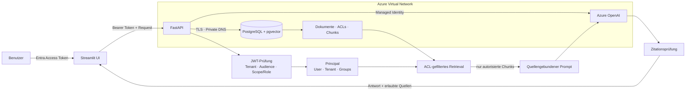

# Azure Enterprise RAG

> Ein sicherheitsorientierter Retrieval-Augmented-Generation-Service, der Unternehmensdokumente nicht nur semantisch durchsucht, sondern Identität, Mandant, Dokumentberechtigung und Quellenbezug über die gesamte Anfrage hinweg durchsetzt.

[](https://www.python.org/)
[](https://fastapi.tiangolo.com/)
[](https://azure.microsoft.com/)
[](https://www.terraform.io/)
[](https://github.com/pgvector/pgvector)
[](https://www.microsoft.com/security/business/identity-access/microsoft-entra-id)

## Warum dieses Projekt?

Ein RAG-Prototyp ist schnell gebaut: Datei hochladen, Text in Chunks zerlegen, Embeddings speichern und die ähnlichsten Treffer an ein Sprachmodell senden.

Für echte Unternehmensdaten reicht das nicht. Die entscheidende Frage lautet nicht nur **„Welcher Chunk passt zur Frage?“**, sondern zuerst:

> **„Welche Chunks darf genau dieser Benutzer in genau diesem Mandanten überhaupt sehen?“**

Dieses Projekt beantwortet beide Fragen in einer zusammenhängenden Architektur. Die Autorisierung wird nicht nachträglich auf bereits geladene Suchtreffer angewendet, sondern direkt in der PostgreSQL-Abfrage. Nur erlaubte Chunks können den Prompt erreichen. Antworten werden zusätzlich an überprüfbare Quellenlabels gebunden.

## Was das System demonstriert

- **Entra-ID-Authentifizierung:** Validierung von Signatur, Issuer, Audience, Tenant, Ablaufzeit und optionalem OAuth-Scope beziehungsweise App-Role.
- **Dokumentbezogene Zugriffskontrolle:** Eigentümer sowie explizite Benutzer- und Gruppenfreigaben pro Dokument.
- **Tenant-isoliertes Retrieval:** pgvector-Suche mit verpflichtendem Tenant- und ACL-Filter direkt in SQL.
- **Quellengebundene Antworten:** Das Modell darf nur aus autorisierten Chunks antworten und muss Aussagen mit `[S1]`, `[S2]` usw. belegen.
- **Sichere Fehlersemantik:** Aussagekräftige HTTP-Statuscodes statt erfolgreicher `200`-Antworten mit versteckten Fehlermeldungen.
- **Private Azure-Datenebene:** PostgreSQL ohne öffentlichen Netzwerkzugang, erreichbar über ein delegiertes Subnetz und Private DNS.
- **Passwordless Azure-Zugriffe:** Managed Identity für Azure OpenAI und ACR Image Pull.
- **Reproduzierbare Infrastruktur:** Netzwerk, PostgreSQL, Container Apps, ACR, Identität, RBAC und Model Deployments als Terraform-Code.
- **Interaktive Demo:** Streamlit-Oberfläche für authentifizierte Uploads, Fragen und nachvollziehbare Quellen.

## Architektur



### Vertrauensgrenzen

1. Das Zugriffstoken wird serverseitig über die Entra-JWKS validiert.
2. `tenant_id`, `user_id` und Gruppen stammen ausschließlich aus validierten Token-Claims.
3. Die Retrieval-Abfrage akzeptiert einen Chunk nur, wenn der Benutzer Eigentümer ist oder eine passende Benutzer-/Gruppenfreigabe besitzt.
4. Optionale Filter wie `filename` oder `document_id` schränken das Ergebnis weiter ein, ersetzen aber niemals die ACL-Prüfung.
5. Das Frontend erhält keine vollständigen Roh-Chunks, sondern ausschließlich validierte Quellenmetadaten.

## Datenmodell

| Tabelle | Zweck |
|---|---|
| `rag_document_metadata` | Dokument-ID, Tenant, Eigentümer, Dateiname und Erstellungszeit |
| `rag_document_permissions` | Explizite `reader`/`editor`-Freigaben für Benutzer oder Gruppen |
| `rag_chunks` | Dokumentreferenz, Tenant, Chunk-Index, Text und 1536-dimensionales Embedding |

Bereits vorhandene Datensätze aus der alten Tabelle `rag_documents` werden absichtlich nicht automatisch übernommen: Ohne verlässliche Eigentümer- und Tenant-Zuordnung wäre eine Migration sicherheitstechnisch nicht vertretbar.

## Tech Stack

| Bereich | Technologie | Aufgabe |
|---|---|---|
| Web UI | Streamlit | Upload, Chat und Quellenanzeige |
| API | FastAPI, Pydantic, Uvicorn | Authentifizierte REST-Endpunkte und Validierung |
| Identity | Microsoft Entra ID, PyJWT | JWT-, Tenant-, Scope- und Rollenprüfung |
| Retrieval | PostgreSQL Flexible Server, pgvector | Persistenz und L2-Vektorsuche mit ACL-Prädikaten |
| AI | Azure OpenAI | Embeddings und quellengestützte Antwortgenerierung |
| Cloud Runtime | Azure Container Apps, ACR | Container-Ausführung und Image Registry |
| Security | Managed Identity, Azure RBAC, Private DNS | Passwordless Service-Zugriffe und private Datenbankanbindung |
| Infrastructure | Terraform | Reproduzierbare Azure-Ressourcen |

## Projektstruktur

```text
azure-enterprise-rag/
├── app/
│   ├── auth.py               # Entra-JWT-Prüfung und Principal-Modell
│   ├── main.py               # FastAPI, Ingestion, ACL-Retrieval und Quellenbindung
│   ├── Dockerfile            # Non-root Backend-Container
│   ├── requirements.txt
│   └── requirements-dev.txt
├── frontend/
│   └── app.py                # Streamlit-Client mit Bearer-Token-Unterstützung
├── terraform/
│   ├── backend.tf            # Remote State Backend
│   ├── main.tf               # Azure-Ressourcen, Netzwerk, Identität und RBAC
│   └── variables.tf
├── tests/
│   └── test_security.py      # Auth-, ACL- und HTTP-Fehler-Regressionstests
└── README.md
```

## API

### `GET /health`

Ein minimaler Health-Endpunkt ohne interne Systemdetails.

### `POST /upload`

Akzeptiert authentifizierte PDF- und TXT-Uploads bis standardmäßig 10 MiB. Das Dokument gehört automatisch dem angemeldeten Benutzer. Optionale Freigaben können als kommaseparierte Entra-Objekt-IDs übergeben werden.

```bash
curl --request POST http://127.0.0.1:8000/upload \
  --header "Authorization: Bearer ${ACCESS_TOKEN}" \
  --form "file=@mein-dokument.pdf" \
  --form "shared_with_groups=<entra-group-object-id>"
```

Beispielantwort:

```json
{
  "document_id": 42,
  "filename": "mein-dokument.pdf",
  "chunks": 7,
  "message": "The document was indexed successfully."
}
```

### `POST /ask`

Die Suche kann optional auf ein Dokument oder einen Dateinamen begrenzt werden. Tenant- und ACL-Filter gelten unabhängig davon immer.

```bash
curl --request POST http://127.0.0.1:8000/ask \
  --header "Authorization: Bearer ${ACCESS_TOKEN}" \
  --header "Content-Type: application/json" \
  --data '{
    "question": "Welche Sicherheitsmaßnahmen werden beschrieben?",
    "filename": "mein-dokument.pdf"
  }'
```

Beispielantwort:

```json
{
  "answer": "Die Datenbank ist ausschließlich über ein privates Netzwerk erreichbar [S1].",
  "sources": [
    {
      "citation": "S1",
      "document_id": 42,
      "filename": "mein-dokument.pdf",
      "chunk_index": 3
    }
  ],
  "request_id": "2f04b76d-81bd-42a1-84fc-49d556721778"
}
```

Enthält die Modellantwort keine gültigen Quellen oder erfindet sie ein unbekanntes Quellenlabel, wird die Antwort verworfen und durch eine sichere, unbelegte-Antwort-Meldung ersetzt.

## Lokale Entwicklung

### Voraussetzungen

- Python 3.11 oder neuer
- erreichbarer PostgreSQL-Server mit freigeschalteter `vector`-Extension
- Azure-OpenAI-Ressource mit Embedding- und Chat-Deployment
- Entra-App-Registrierung, die ein API-Scope oder eine App-Role bereitstellt

### Installation

```bash
git clone https://github.com/Marziehfth95/Lernen-und-Projekte.git
cd Lernen-und-Projekte/Projects/azure-enterprise-rag

python -m venv .venv
source .venv/bin/activate
pip install -r app/requirements-dev.txt
```

### Backend konfigurieren

Beispiel für `app/.env`:

```dotenv
OPENAI_ENDPOINT=https://<resource-name>.openai.azure.com/
OPENAI_API_KEY=<nur-fuer-lokale-entwicklung>

DB_HOST=<server>.postgres.database.azure.com
DB_USER=<database-user>
DB_PASS=<database-password>
DB_NAME=postgres

AUTH_TENANT_ID=<entra-tenant-id>
AUTH_CLIENT_ID=<entra-api-client-id>
AUTH_REQUIRED_SCOPE=access_as_user
# AUTH_REQUIRED_ROLE=Rag.User
```

In Azure wird kein `OPENAI_API_KEY` benötigt: Dort verwendet das Backend die zugewiesene Managed Identity.

### Anwendungen starten

Terminal 1:

```bash
cd app
uvicorn main:app --reload --env-file .env
```

Terminal 2:

```bash
source .venv/bin/activate
API_URL=http://127.0.0.1:8000 streamlit run frontend/app.py
```

Das Frontend erwartet ein Entra Access Token für die konfigurierte API-Audience. Es kann im geschützten Eingabefeld eingetragen oder für lokale Tests über `API_BEARER_TOKEN` bereitgestellt werden.

## Tests

```bash
pytest -q
```

Die Regressionstests prüfen unter anderem:

- Requests ohne Bearer Token werden mit `401` abgewiesen.
- Entra-Claims werden in einen vertrauenswürdigen Principal überführt.
- Die Retrieval-SQL enthält Tenant-, Eigentümer-, Benutzer-, Gruppen- und Dateifilter.
- Eine Suche ohne autorisierte Treffer liefert `404` statt einer irreführenden HTTP-200-Fehlerantwort.

## Azure Deployment mit Terraform

```bash
cd terraform
terraform init
terraform fmt -check
terraform validate
terraform plan \
  -var="auth_tenant_id=<tenant-id>" \
  -var="auth_client_id=<api-client-id>" \
  -var="db_password=<strong-password>"
terraform apply
```

`external_ingress_enabled` ist standardmäßig `false`. Ein öffentlich erreichbares Backend muss bewusst mit `-var="external_ingress_enabled=true"` aktiviert werden; die JWT-Prüfung bleibt dabei verpflichtend.

> **Wichtig bei bestehenden Umgebungen:** Der Wechsel eines bereits öffentlich provisionierten PostgreSQL Flexible Servers auf ein delegiertes privates Subnetz kann einen Ressourcenaustausch auslösen. Vor dem Apply immer Backup, State und `terraform plan` prüfen.

## Security by Design

| Risiko | Gegenmaßnahme |
|---|---|
| Anonymer API-Zugriff | Entra-JWT-Prüfung auf allen datenverarbeitenden Endpunkten |
| Cross-Tenant Data Leakage | Verbindlicher `tenant_id`-Filter in jeder Retrieval-Abfrage |
| Zugriff auf fremde Dokumente | Owner-, Benutzer- und Gruppen-ACL direkt im SQL-Prädikat |
| Manipulierter Dateifilter | Dateiname schränkt nur innerhalb der bereits autorisierten Datenmenge ein |
| Öffentliche Datenbank | `public_network_access_enabled = false`, delegiertes Subnetz, Private DNS |
| Registry-/OpenAI-Secrets | User Assigned Managed Identity und minimal benötigte RBAC-Rollen |
| Fehlerdetails im Frontend | Stabile `4xx`/`5xx`-Antworten, interne Details nur im Server-Log |
| Halluzinierte Quellen | Abgleich aller Quellenlabels mit der autorisierten Retrieval-Menge |
| Container-Eskalation | Ausführung als dedizierter Non-root-Benutzer |

## Bewusste Designentscheidungen

- **PostgreSQL statt zusätzlicher Vector Database:** Relationale Metadaten, Berechtigungen und Embeddings können transaktional gemeinsam verwaltet werden.
- **Fail closed:** Fehlende Auth-Konfiguration, ungültige Token, nicht zuordenbare Altbestände oder unbelegte Antworten werden nicht stillschweigend akzeptiert.
- **Autorisierung vor Prompt-Erstellung:** Nicht erlaubte Chunks verlassen die Datenbankabfrage nicht.
- **Interner Ingress als Standard:** Öffentliche Erreichbarkeit ist eine explizite Deployment-Entscheidung.

## Nächste sinnvolle Ausbaustufen

- PostgreSQL Row-Level Security als zusätzliche Defense-in-Depth-Schicht
- Dedizierte Migrationen und getrennte Datenbankrollen für Schema- und Runtime-Zugriff
- Hybrid Search aus Vektor-, Volltext- und Re-Ranking-Stufe
- Microsoft Graph-Auflösung für Entra Group-Overage-Claims
- Application Insights, OpenTelemetry und LLM-Tracing ohne sensible Dokumentinhalte
- Rate Limiting, Malware-Scanning und asynchrone Ingestion großer Dokumente
- Automatisierte CI-Pipeline für Tests, Container-Scan und Terraform Security Checks

---

Dieses Projekt ist Teil meines Cloud- und AI-Engineering-Portfolios. Es zeigt den Schritt vom funktionierenden RAG-Demo-Flow zu einer Architektur, die Sicherheitsgrenzen, Datenisolation und nachvollziehbare Antworten als Kernfunktionen behandelt.
