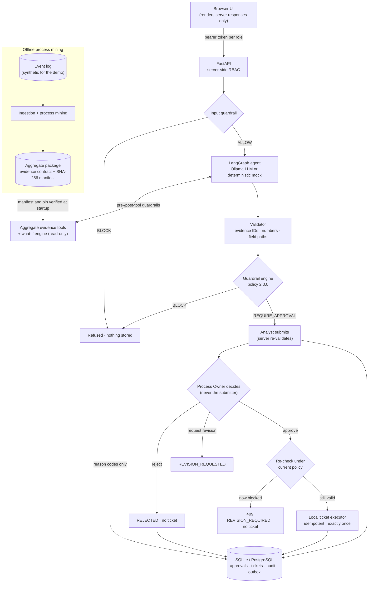

# IT Service Process Optimization Agent

**Evidence-grounded agentic AI for IT service management and process improvement**


This system analyses an IT incident-management process from its event log. An AI agent
investigates what the data shows, and the result becomes a **governed** improvement
action. **The model proposes, deterministic code decides, and a human approves.**

It analyses the *process*, not individual tickets. It is not a ticket-resolution assistant
and not a RAG chatbot.

> **Demo data is synthetic.** The public demo runs on invented, seeded records that the
> real pipeline processes. The UI marks them `SYNTHETIC DATA · NOT BPI 2013`. No figure in the
> demo is a research result about a real organisation. See [Data](#data-and-attribution).

---

## Why this project

Service desks produce large event logs, and process owners want to know where incidents
lose time, for example when tickets bounce back to a support group they already visited.
Letting a language model analyse that data directly is risky. It can invent numbers,
present correlations as causes, promise savings no one has measured, or trigger changes
nobody approved.

This project splits the work along a clear line:

| Probabilistic (LLM) | Deterministic (code) |
|---|---|
| Selecting relevant evidence | Process mining and aggregate evidence |
| Forming hypotheses | Validating every evidence ID and number |
| Drafting a recommendation | Guardrail policy decisions (`ALLOW` / `REQUIRE_APPROVAL` / `BLOCK`) |
| | Approval, separation of duties, idempotent execution, audit |

## Key capabilities

- **Process mining**: XES ingestion (pm4py), with directly-follows transitions, handoffs,
  group returns, lifecycle decomposition and transparent bottleneck rules computed in pandas.
- **Evidence contract**: an immutable, versioned Pydantic contract of aggregate findings,
  pinned by SHA-256. The services refuse to start if the contract or the policy has changed.
- **Agentic investigation**: a LangGraph agent (analyst → investigator → tools → optimizer →
  validator) with budgets for iterations, tool calls, model calls, tokens and wall time. It
  has seven typed, read-only tools: no SQL, no file access, no write tools.
- **Real local LLM**: an Ollama provider (default `qwen3.5:9b`) with schema-constrained
  output, loopback only. It never downloads a model and never falls back to mock output.
- **Deterministic mock mode**: the same graph, tools and checks without a model, labelled
  `DETERMINISTIC_MOCK_NOT_REAL_AI`. This is the reliable default.
- **Evidence-grounded recommendations**: every number, in structured facts *and* in free
  text, must match the cited finding or a value derived from it.
- **What-if simulation**: hypothetical scenarios for reducing repeated handoffs. Time and SLA
  effects are reported as `NOT_ESTIMABLE` rather than guessed.
- **Deterministic guardrails**: 37 policy rules at 8 checkpoints. The most restrictive
  decision wins.
- **Human-in-the-loop**: Analyst, Process Owner and Admin roles enforced server-side, with
  separation of duties and re-validation against the current policy before execution.
- **Idempotent execution and audit**: exactly one local ticket per approval, even under
  replays and concurrent requests, plus an append-only audit trail with reason codes only.

## Architecture



A recommendation never executes automatically: the best it can get from the guardrails is
`REQUIRE_APPROVAL`. The browser demo is a separate app that mounts the unchanged production
routers; the production app never imports it. Details: [architecture](docs/architecture.md),
[agent](docs/agent_architecture.md), [evidence contract](docs/evidence_contract.md),
[guardrail coverage](docs/guardrail_policy_coverage.md).

## Tech stack

| Area | Technologies |
|---|---|
| API and schemas | Python 3.12, FastAPI, Uvicorn, Pydantic v2 |
| Agent | LangGraph; Ollama (local LLM, default `qwen3.5:9b`) |
| Analytics | pm4py (XES ingestion), pandas, PyArrow / Parquet |
| Persistence | SQLAlchemy 2, SQLite, PostgreSQL (psycopg 3) |
| Quality | pytest, Ruff, hash-locked dependency sets |
| Frontend | Plain HTML, CSS and JavaScript; strict CSP, no CDN, no build step |
| Optional, experimental | Microsoft Foundry provider and Hosted Agent entry point, Entra ID JWT validation, OpenTelemetry, Docker, `azure.yaml`, Terraform |

The Azure parts were deployed once to a short-lived development environment, where the
hosted agent **never became operational**. They are kept as reference code; the demo needs
no Azure account.

## Quick start

Prerequisites: Python 3.12 and Git. Optional: [Ollama](https://ollama.com) for real local AI,
and PostgreSQL 16+ (`initdb`, `pg_ctl`) for the PostgreSQL tests.

```bash
git clone https://github.com/Marziehfth95/Lernen-und-Projekte.git
cd Lernen-und-Projekte/Projects/it-service-process-optimization-agent

python3.12 -m venv .venv            # the scripts expect the environment at .venv
source .venv/bin/activate
python -m pip install --upgrade pip
python -m pip install -e '.[dev]' -c ci/demo-constraints.txt

scripts/prepare_public_demo_data.sh # builds the synthetic evidence package (a few seconds)
scripts/run_interactive_demo.sh     # starts the demo on 127.0.0.1:8765
```

Open **<http://127.0.0.1:8765/app/>**. Stop with Ctrl+C; the disposable database is deleted.

`prepare_public_demo_data.sh` runs the production pipeline on seeded, invented records:
process mining → evidence contract → aggregate manifest → deployable package. It then checks
every artifact hash and the served-evidence pin against reviewed values and fails on any
difference. The constraints file pins the libraries that determine the Parquet bytes.

**Real local AI (optional):**

```bash
ollama pull qwen3.5:9b                                   # once, about 6.6 GB
scripts/run_interactive_demo.sh                          # then choose "Real Local AI (Ollama)"
scripts/run_interactive_demo.sh --ollama-model <model>   # any other locally installed model
```

**Scripted end-to-end check** (25 checks). The PostgreSQL run also needs `initdb`/`pg_ctl`
on `PATH` and the `cloud` extra (psycopg):

```bash
scripts/run_local_e2e_demo.sh sqlite
python -m pip install -e '.[dev,cloud]' -c ci/demo-constraints.txt
scripts/run_local_e2e_demo.sh both
```

## Demo walkthrough

The role switcher uses synthetic local identities; the server authorizes every action. The
**Server calls** strip lists every request with its role and HTTP status.

1. **Inspect process evidence** (Analyst · *1 Evidence*): cohort comparison, handoffs,
   lifecycle patterns and provenance, including how many findings small-group suppression
   withheld.
2. **Investigate** (*2 Investigate*): run *Repeated group returns* with the default
   *Deterministic Demo* model and follow the graph steps and tool calls.
3. **Compare a what-if scenario** (*3 What-if*): three assumption sets with hypothetical
   event reductions; time and SLA effects are `NOT_ESTIMABLE`.
4. **Review the recommendation**: cited evidence IDs, numbers with field paths, hypotheses,
   limitations and uncertainty.
5. **Observe the guardrails**: as generated, the decision is `REQUIRE_APPROVAL`. Choose the
   wording *Unsafe: causal claim* or *unsupported effect*: the decision becomes `BLOCK` and
   the server refuses the submission (422).
6. **Submit as Analyst**, then *Resubmit identical request*: the same approval request comes
   back, with no duplicate.
7. **Approve as Process Owner** (*4 Approvals*): Analyst and Admin get 403, and a user with
   both roles cannot approve their own submission (`SELF_APPROVAL_PROHIBITED`). The Process
   Owner's approval is re-checked against the current policy, then executed.
8. **Inspect the ticket and audit trail** (*5 Tickets*, Admin · *6 Audit*): exactly one local
   ticket. A replay changes nothing, and a new decision key gets 409.

Also try the *KNOWN GAP* wording (see [limitations](#known-limitations)), which reaches review
and must be rejected by a person. As Admin, *simulated stricter policy* shows
`409 REVISION_REQUIRED`. More: [docs/interactive_demo.md](docs/interactive_demo.md).

## Testing

```bash
ruff check .
python -m pip install -e '.[dev,agents,cloud,observability]' -c ci/demo-constraints.txt
python -m pytest -q -m "not model"                  # the opt-in paid-model test is deselected

# With PostgreSQL integration tests (disposable local cluster)
initdb -D /tmp/po-pg -U postgres --auth=trust
pg_ctl -D /tmp/po-pg -o "-p 55434 -c listen_addresses=127.0.0.1" -w start
PROCESS_OPTIMIZER_TEST_POSTGRES_ADMIN_URL=postgresql+psycopg://postgres@127.0.0.1:55434/postgres \
  python -m pytest -q -m "not model"
pg_ctl -D /tmp/po-pg -m immediate stop

# Model-free evaluation suites
process-optimizer-evaluate --analysis-dir demo-data/public-synthetic-aggregates --suite validator --mode mocked_llm
process-optimizer-evaluate --analysis-dir demo-data/public-synthetic-aggregates --suite agent --mode mocked_llm
```

The suite needs all four extras: with only `[dev]`, three test modules fail at import.
Without the PostgreSQL URL, the PostgreSQL tests are skipped.

**Results for this public version** (2026-11-06; macOS, Python 3.12, clean environment,
synthetic package):

| Check | Result |
|---|---|
| Ruff | pass |
| pytest with all extras and PostgreSQL 18 | 796 passed, 0 skipped, 1 deselected |
| 25-check end-to-end demo, SQLite and PostgreSQL | 25/25 on both; result digest equals the reviewed value |
| Validator suite / mocked agent evaluation | 25/25 / 2/2 |
| Interactive demo walkthrough over HTTP | all checks passed, including the full approval and ticket flow |
| Real local AI (`qwen3.5:9b`) | genuine inference works; **no run on the synthetic package has produced an approvable recommendation** (see limitations) |

All test fixtures use synthetic values. One regression fixture keeps the *wording* of a
model-written recommendation, with synthetic numbers and IDs
(`tests/data/model_text_regression_recommendation.json`).

## Security and governance

- **Evidence grounding.** The agent sees aggregates, never event rows. Evidence IDs and
  numbers are checked down to field path and stated precision. Text is never rewritten to
  make it pass.
- **Data minimisation and small-group suppression.** Raw data stays out of Git,
  `org:resource` is excluded from analysis, and findings based on fewer than *k* = 10
  observations are withheld by the server.
- **Deterministic, pinned policy.** A versioned JSON policy (schema 2.0.0) blocks causal
  wording, unsupported effects, unknown evidence and unsafe automation, and returns reason
  codes.
- **RBAC and separation of duties.** Roles are enforced server-side. Admins can audit but
  cannot read evidence or approve; service identities cannot approve; submitters cannot
  approve their own work.
- **Policy revalidation and idempotency.** Approvals record the policy they were validated
  under and are re-checked before execution. Execution is exactly once, tested on SQLite and
  PostgreSQL.
- **Audit.** Append-only rows (enforced by database privileges on PostgreSQL) hold codes and
  identities, never recommendation text.
- **Local isolation.** The demo refuses to start outside `APP_ENV=local` or with cloud
  credentials present. It binds to 127.0.0.1, refuses non-loopback connections and uses a
  temporary database per launch.

See [security model](docs/security_model.md) and [data governance](docs/data_governance.md).

## Known limitations

- **Open guardrail gap `OPEN_NOT_SAFE`.** Policy 2.0.0 does not block a plain causal verb, for
  example *"Repeated group returns cause longer case spans and delay closure."* Such a
  recommendation reaches human review, and only the Process Owner's rejection stops it. The
  demo shows this on purpose; it is not fixed.
- **Real local AI on synthetic data.** Inference is genuine (verified model, tokens and
  latency per call). In the recorded runs on the synthetic package, `qwen3.5:9b` produced no
  approvable recommendation: the guardrails blocked it (`MISSING_SIMULATION_CITATION`), or the
  run ended safely on its tool budget. The full approval and ticket flow is demonstrated with
  the deterministic provider. Model output is probabilistic, and only one scenario/model
  combination has ever validated (on the original dataset, not reproducible here).
- **Numerical, not semantic, grounding.** Supported numbers are checked, but not whether they
  describe the right subject or the right direction of a comparison.
- **What-if is hypothetical.** It is arithmetic under assumptions you choose, not a
  measurement, a forecast or a causal estimate. No process savings have been demonstrated.
- **Synthetic data is sparse.** 5 of 8 findings are withheld by suppression, no transition
  meets the bottleneck rule (the UI explains this), and there is no process-variant artifact.
- **No proven Azure operation.** The Entra, managed-identity PostgreSQL, Foundry and Terraform
  code is unit-tested only. The hosted agent never became operational.
- **Local demo, not production.** Synthetic identities, a temporary database and a local
  ticket executor stand in for an identity provider, a managed database and an ITSM system.

## Project structure

```text
it-service-process-optimization-agent/
├── src/process_optimizer/
│   ├── data/            XES ingestion, profiling, quality checks
│   ├── process_mining/  metrics, bottleneck rules, semantic validation, evidence contract
│   ├── tools/           read-only aggregate tools, manifest verification
│   ├── agents/          LangGraph workflow, providers (mock, Ollama, Foundry), validator
│   ├── guardrails/      policy.v1.json, engine, claim checks, suppression
│   ├── simulation/      what-if engine
│   ├── workflow/        approvals, execution, notifications, audit
│   ├── persistence/     SQLAlchemy models and migrations
│   ├── security/        local and Entra authentication, roles, permissions
│   ├── api/             FastAPI routers
│   ├── demo/            interactive local demo and browser UI
│   └── evaluation/      validator and agent evaluation suites
├── tests/               offline test suite and synthetic fixtures
├── scripts/             demo launchers, synthetic package generator, report gate
├── docs/                architecture, methodology, governance, ADRs (index: docs/README.md)
├── ci/                  dependency locks, demo constraints, reference CI workflow
├── deploy/, infra/      optional Docker, azd and Terraform reference (experimental)
└── demo-data/           generated synthetic package (git-ignored)
```

## Data and attribution

The pipeline was designed for the **BPI Challenge 2013 – Incidents** event log, published by
4TU.ResearchData:

- Dataset: <https://data.4tu.nl/datasets/0fc5c579-e544-4fab-9143-fab1f5192432>
- DOI: [10.4121/uuid:500573e6-accc-4b0c-9576-aa5468b10cee](https://doi.org/10.4121/uuid:500573e6-accc-4b0c-9576-aa5468b10cee)
- Terms of use: <https://doi.org/10.4121/resource:terms_of_use>

This repository does **not** contain the dataset, any record from it, or any aggregate
package or analysis result computed from it. The only dataset figures in the docs are the
publisher's own reference metadata (file size, MD5, approximate case and event counts), which
let you verify your download. To analyse the real log, download it yourself under
the publisher's terms and follow [docs/ingestion_pipeline.md](docs/ingestion_pipeline.md). The
public demo uses synthetic data only, labelled
`SYNTHETIC CI FIXTURE - NOT BPI CHALLENGE 2013 - NOT EVIDENCE`.

## License

Project code and documentation: [MIT](LICENSE) © 2026 Marzieh Fattahi. Third-party
dependencies, model weights and the BPI Challenge 2013 dataset are **not** covered by this
license. They keep their own terms, listed in [THIRD_PARTY_NOTICES.md](THIRD_PARTY_NOTICES.md).
Note that pm4py, used only for XES ingestion, is licensed under AGPL-3.0.
